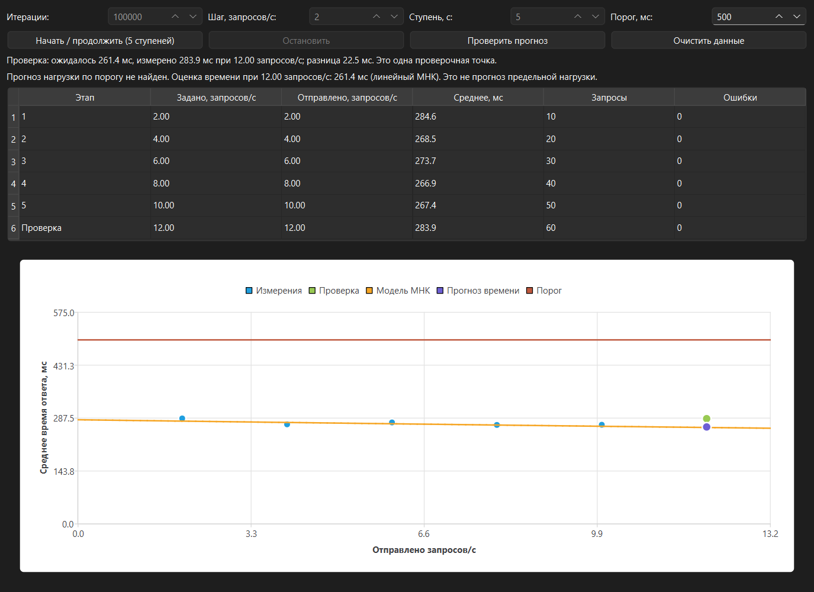

# Прогнозирование нагрузки веб-сервера

Учебный проект по численным методам. Приложение на C++ и Qt отправляет запросы к серверу с возрастающей частотой, измеряет время ответа и строит прогноз по полученным данным.



## Возможности

- Ступенчатое тестирование HTTP API с заданными частотой, длительностью и объёмом вычислений.
- Таблица замеров, ошибок и график времени ответа.
- Подбор математической модели методом наименьших квадратов.
- Поиск нагрузки, при которой модель достигает заданного порога, методом половинного деления.
- Проверка прогноза на отдельной ступени.

Если подходящее пересечение с порогом не найдено, приложение показывает оценку времени ответа на следующей ступени. Эта оценка не является прогнозом предельной нагрузки.

## Устройство проекта

```text
server_load_forecast/
├── src/                  Исходный код и интерфейс Qt Designer
├── docs/                 Презентация и снимки приложения
├── CMakeLists.txt        Конфигурация сборки
└── README.md
```

## Требования

- Qt 6.5 или новее: модули Core, Widgets, Network и Charts.
- CMake 3.19 или новее.
- Компилятор C++ и Qt Creator либо другая среда с поддержкой CMake.
- Доступный сервер с совместимым API.

## Запуск

1. Откройте `CMakeLists.txt` в Qt Creator.
2. Выберите комплект сборки с Qt 6 и настройте проект.
3. Соберите и запустите приложение.
4. Укажите параметры опыта и нажмите «Начать / продолжить».

Базовый адрес API задаётся в `src/mainwindow.cpp`. Чтобы использовать другой сервер без изменения исходного кода, можно задать переменную окружения `SERVER_BENCHMARK_URL`, например `http://127.0.0.1:8888`, до запуска приложения.

Приложение отправляет `POST /benchmark/cpu?iterations=...` и ожидает JSON-ответ со значением `"status": "success"`. Серверная часть находится вне этого репозитория.

## Материалы

- [Презентация проекта](<docs/Презентация проекта.pptx>)
- [Второй опыт в приложении](docs/images/experiment-2.png)

## Ограничения

Время измеряется на стороне клиента и включает сеть, ожидание и обработку сервером. Отправленная клиентом частота может отличаться от интенсивности запросов, полученной сервером. Модель является приближением; проверочная точка сама по себе не определяет точный предел сервера.
